# BetterMe 项目总结文档

页面 · Activity · XML 视图 · 交互逻辑 · 本地存储 · 项目架构

日期：2026-10-31

## 项目概览与阅读导航

BetterMe 是一款以本地记录为中心的 Android 应用，围绕“每日记录”和“成长复盘”组织文字、清单、照片与视频。主流程已覆盖创建、查看、编辑、删除和按主题归类。

| 项目项 | 当前源码实现 |
|---|---|
| 工程组织 | 单模块 :app；包名 com.betterme.app；Kotlin + XML Views + ViewBinding |
| 页面规模 | 7 个 Activity；2 个首页 Fragment；1 个添加记录 DialogFragment；17 个 layout XML |
| 存储架构 | 私有 JSON 保存完整记录；Room 保存可重建元数据索引；SharedPreferences 保存草稿 |
| 媒体能力 | Glide 图片加载；MediaStore 相册查询；Media3 ExoPlayer 播放、Transformer 合成 |
| 版本配置 | versionName 0.1.0；versionCode 1；minSdk 23；compileSdk / targetSdk 34 |
| 工具链 | Gradle 8.7；AGP 8.5.1；Kotlin 1.9.0；KSP 1.9.0-1.0.13；Java 17 |
| 主要依赖 | Glide 4.16.0；Room 2.6.1；Media3 1.3.1；协程 1.7.3；Lifecycle 2.8.7 |
| 网络边界 | Manifest 声明 INTERNET，但当前 Gradle 未引入 Retrofit，也未发现业务 API 调用 |

### 阅读顺序

先看架构和页面索引，再按页面阅读交互；后半部分说明 Intent 契约、存储结构、保存与恢复、媒体任务和维护边界。最后附截图目录与源码定位。

### 资料基线

源码梳理日期：2026-10-31。真机截图来自已安装的 0.1.0 应用，设备型号 V2509A，截图分辨率 1216 × 2640，安装包最近更新于 2026-10-29。未重建或重新安装应用，因此截图版本与工作区源码的一致性尚未通过构建核验。

源码依据：app/build.gradle.kts；build.gradle.kts；settings.gradle.kts；app/src/main/AndroidManifest.xml

## 项目架构与职责边界

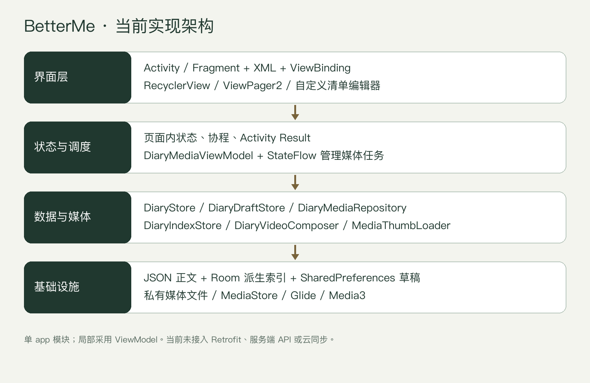

架构采用 Activity / Fragment 驱动的页面组织方式，并在媒体处理链路引入 ViewModel 与 StateFlow。它不是完整的统一 MVVM：列表直接调用 DiaryStore，DiaryActivity 仍负责编辑状态、校验、生命周期与部分业务编排。

DiaryStore 是记录读写入口；DiaryIndexStore 封装 Room 查询与恢复；DiaryMediaRepository 负责私有拷贝和任务日志；DiaryVideoComposer 负责媒体导出。DayRecordViewModel 目前仅保留空 async 示例，未发现页面使用。

源码依据：MainActivity.kt；DiaryActivity.kt；diary/DiaryStore.kt；diary/DiaryMediaViewModel.kt；DayRecordViewModel.kt

## 页面导航与 Activity 索引

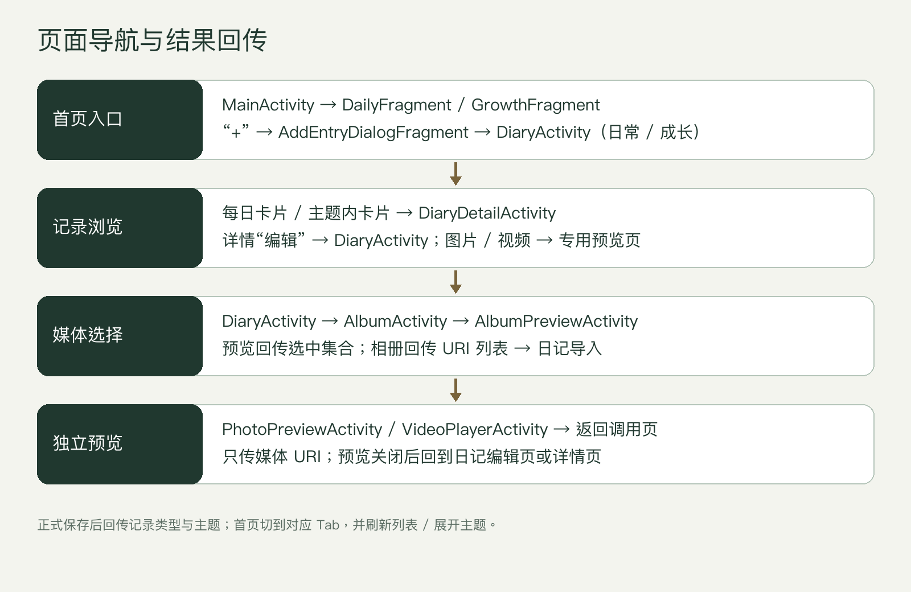

| Activity | 根视图 XML | 角色 |
|---|---|---|
| MainActivity | activity_main.xml | 首页容器与 Tab |
| DiaryActivity | activity_diary.xml | 正式记录编辑 |
| AlbumActivity | activity_album.xml | 相册多选 |
| AlbumPreviewActivity | activity_album_preview.xml | 选中态预览 |
| DiaryDetailActivity | activity_diary_detail.xml | 已保存记录详情 |
| PhotoPreviewActivity | activity_photo_preview.xml | 只读图片放大 |
| VideoPlayerActivity | activity_video_player.xml | 独立视频播放 |

Activity 源码目录为 app/src/main/java/com/betterme/app/；根布局目录为 app/src/main/res/layout/。MainActivity 是唯一 exported=true 的 Activity。视频页允许 fullSensor，其余页面锁定竖屏。

## MainActivity · 每日与成长首页

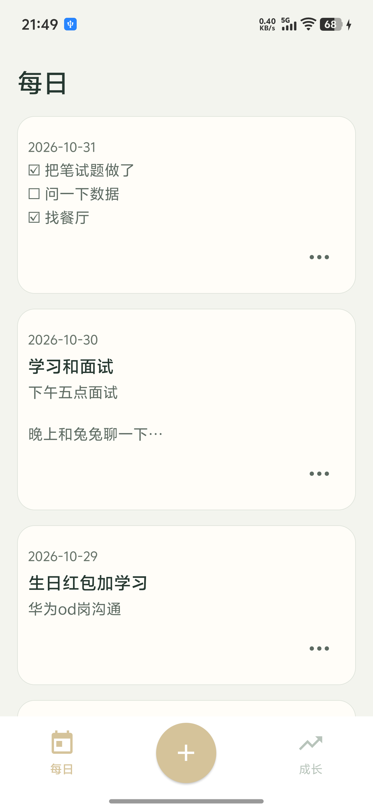

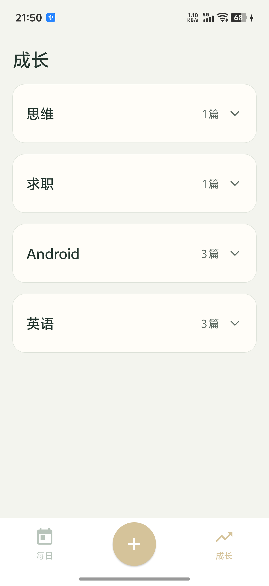

| 文件 / 控件 | 职责 |
|---|---|
| activity_main.xml | fragmentContainer 承载页面；tabDaily / tabGrowth 切换；plusButton 添加 |
| ui/DailyFragment.kt + fragment_daily.xml | 日常分页列表、空态、失败重试、删除确认 |
| ui/GrowthFragment.kt + fragment_growth.xml | 主题聚合、篇数、单主题展开、主题内分页 |

switchTab / applyPendingTab 使用 add、show、hide 保留两个页面，并通过 setMaxLifecycle 控制活动状态。串行提交 Fragment 事务以避免快速点击重复添加；保存后按 DAILY / GROWTH 跳转，待目标 Fragment 真正显示后再刷新。

源码依据：MainActivity.kt：openDiary / applyPendingTab / showSavedDiary；ui/DailyFragment.kt；ui/GrowthFragment.kt

## 首页交互 · 添加与主题展开

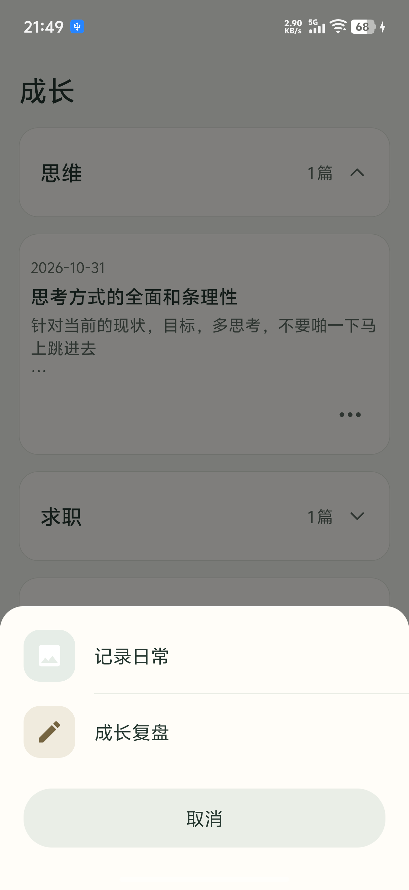

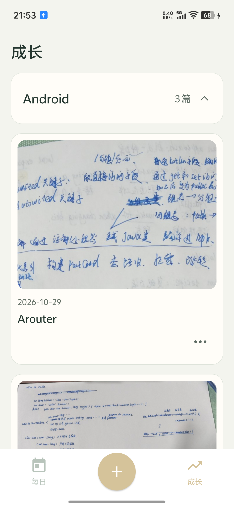

AddEntryDialogFragment 使用 dialog_add_entry.xml。记录日常调用 openDiary()；成长复盘传入 GROWTH；取消关闭弹层。当前只有这两个业务入口，README 已同步说明。

每日列表默认每页 10 条，接近底部时继续加载；失败时通过 DiaryPageAdapter 显示重试。成长列表使用 ConcatAdapter 拼接主题头、共享文章列表和分页尾部；同一时间只有一个主题展开。

卡片的图片轮播、视频封面和摘要由 DailyEntryAdapter 复用，点击内容进入详情，更多按钮触发删除确认。列表保留滚动锚点及图片页码；成长主题篇数来自索引聚合，不是当前分页条数。

源码依据：ui/AddEntryDialogFragment.kt；ui/DailyEntryAdapter.kt；ui/GrowthTopicAdapter.kt；ui/DiaryPageAdapter.kt

## DiaryActivity · 正式编辑页

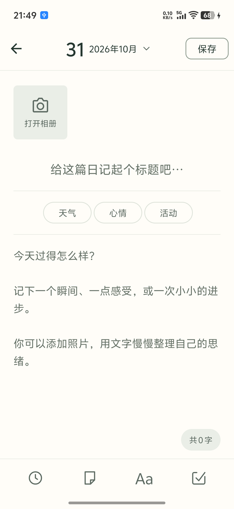

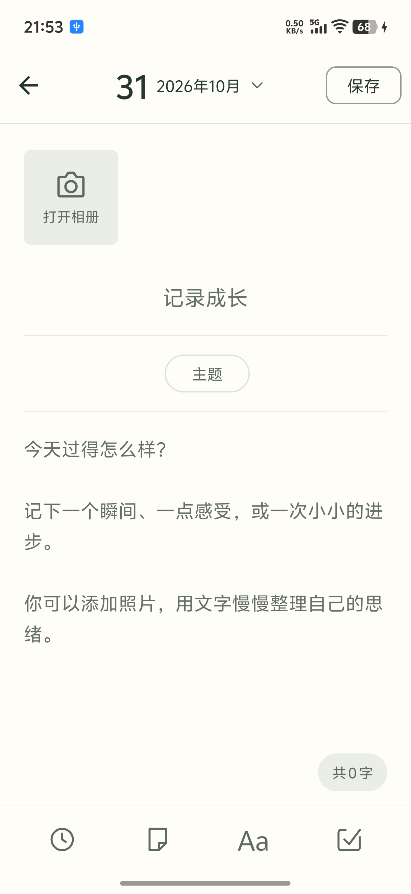

| 视图 / 组件 | 具体作用 |
|---|---|
| activity_diary.xml | btnDate、btnSave、btnAddPhoto、etTitle、标签、contentEditor、底部工具栏 |
| DiaryContentEditor + DiaryRowEditText | 分行文本与可勾选清单；item_diary_editor_row.xml 提供行布局 |
| dialog_diary_unsaved.xml | 内容已变更时，选择退出不保存或继续编辑 |

日常模式显示天气、心情和活动；成长模式显示主题。标题最多 80 字符，正文序列化长度上限 20,000；字体可选 14 / 16 / 18 / 20sp，纸张背景有三种。时间工具插入 HH:mm，清单使用“☐ ”与“☑ ”前缀保存在正文中。

源码依据：DiaryActivity.kt：onCreate / loadEntry / snapshot；DiaryContentEditor.kt：parse / serialize / fits

## DiaryActivity · 数据恢复与退出规则

### 进入页面

新建记录按 diary_entry_kind 选择日常或成长草稿；编辑已有记录通过 diary_entry_id 从 DiaryStore 读取。恢复优先选择 savedInstanceState，其次草稿，再其次已保存记录或新建对象。旧编辑草稿只有在 updatedAt 与当前记录一致时才被采用，避免覆盖更新后的版本。

### 编辑与校验

snapshot 汇总标题、正文和当前媒体状态；SHA-256 fingerprint 判断是否有修改。成长主题默认提供 Android、AI、英语，也允许自定义，长度上限 30。名称裁剪和合并连续空白，比较键转为 Locale.ROOT 小写；大小写不同的同名主题会合并。

### 媒体处理期间

DiaryMediaViewModel 通过 StateFlow 返回恢复、导入、合成、完成或错误状态。媒体处理时禁用保存和重新选择，但文字编辑可继续。可取消或重试；返回键先询问是否停止处理，再处理未保存内容。

### 草稿与退出

onStop 在页面未结束、记录已就绪且未保存时写入草稿；系统状态还保存选区与滚动位置。主动退出时，内容无变化直接清理会话；有变化则弹出“退出 / 继续编辑”。主动选择退出会清除对应草稿并清理无引用媒体，并非点击返回就永久保存草稿。

### 正式保存

拒绝标题、正文和媒体均为空的记录；成长记录还必须填写主题。保存写入 updatedAt，成功后清草稿、结束媒体会话并回传 saved_diary_id、diary_entry_kind、saved_topic。文件读取或保存失败会显示提示，读取失败提供重试。

源码依据：DiaryActivity.kt：loadEntry / onStop / fingerprint / chooseTopic / save / requestExit；diary/DiaryDraftStore.kt；diary/GrowthTopics.kt

## AlbumActivity · 相册多选

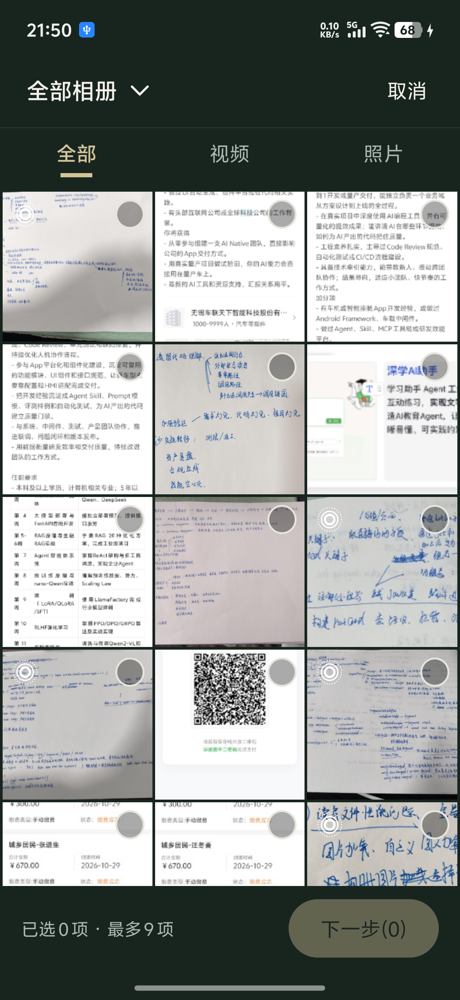

activity_album.xml 包含 btnAlbum、全部/视频/照片筛选、三列 recycler、selectedStrip 和 btnNext。AlbumAdapter 展示网格与序号；AlbumSelectedAdapter 展示底部已选条目并支持移除；AlbumMediaSwipeLayout 支持横向手势切换筛选。

通过 MediaStore 查询图片与视频，并按 dateAdded、id 降序合并。LinkedHashMap 保持选择顺序，最多 9 项，跨相册和筛选保留选择；点击缩略图预览，点击角标选择。超限提示最多每 3 秒一次，空选择不能下一步。

Android 13 使用 READ_MEDIA_IMAGES / VIDEO；Android 14 同时处理部分照片授权；旧系统使用 READ_EXTERNAL_STORAGE。授权变动后 onResume 重查。已导入素材可用 local_media 私有副本作为缩略图回退。

源码依据：AlbumActivity.kt：loadMedia / query / refreshGrid / confirmSelection；AlbumAdapter.kt；AlbumSelectedAdapter.kt

## AlbumPreviewActivity · 选择过程中的预览

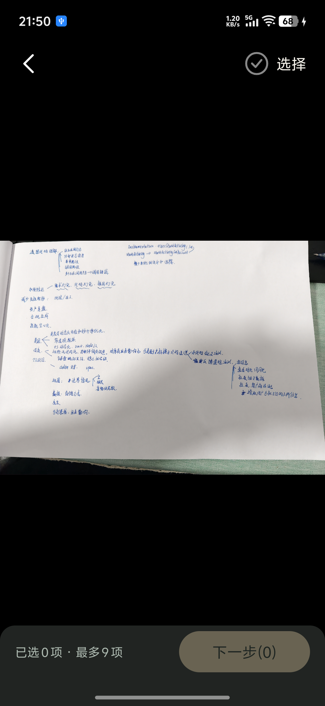

activity_album_preview.xml 将 ZoomImageView、PlayerView、选择按钮、已选缩略图条、进度条与下一步按钮组合在同一页面。入口只传当前一项和最多 9 个已选项，不通过 Binder 传递整个相册。

预览本身不会选中素材。点击选择或底部删除才改变集合；点击已选缩略图切换当前项。返回也以 RESULT_OK 回传选中集合，但 preview_confirm=false；下一步设置 true，由相册继续完成结果回传。

视频初始不自动播放，支持播放/暂停和拖动进度；onStop 释放播放器，并保留播放位置与意图。图片优先加载 localUri，失败显示重试。当前实现不是对整个相册左右滑动的 ViewPager 预览。

源码依据：AlbumPreviewActivity.kt：showItem / toggleCurrent / finishSelection / releasePlayer；AlbumPreviewContract.kt

## DiaryDetailActivity · 已保存内容详情

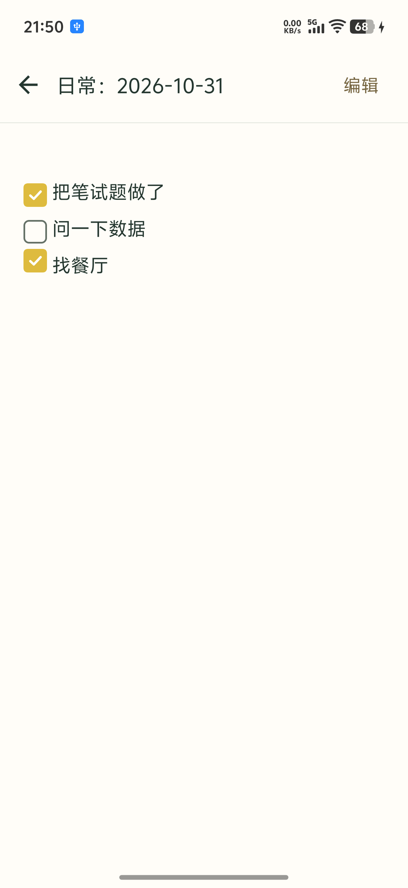

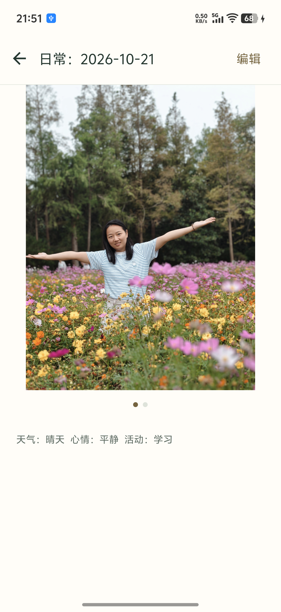

activity_diary_detail.xml 包含 heading、btnEdit、contentScroll、mediaPager、pageDots、title、tags 与 body。DiaryDetailMediaAdapter 对应 item_diary_detail_media.xml；图片区域按第一项宽高比调整，最大不超过可用根视图高度的 68%。

入口传 detail_entry_id 和可选 detail_initial_page。页面从 DiaryStore 重读已保存记录，不读取草稿。图片点击进入 PhotoPreviewActivity；单视频或合成视频进入 VideoPlayerActivity；编辑跳转 DiaryActivity 并继续传递保存结果。

清单在详情中只读展示，以图形与读屏文本表达勾选状态。onResume 重读记录，保留滚动位置与媒体页码；已读内容失效时显示错误和重试，避免进入无效编辑状态。

源码依据：DiaryDetailActivity.kt：loadEntry / render / readOnlyBody；ui/DiaryDetailMediaAdapter.kt

## 独立媒体页 · 图片与视频

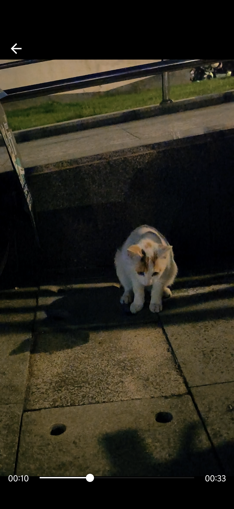

| 页面 | 交互与生命周期 |
|---|---|
| PhotoPreviewActivity activity_photo_preview.xml | photo_uri → Glide → ZoomImageView；完整适配图片、双指缩放 1–5 倍、边界约束拖动；失败重试；只读。 |
| VideoPlayerActivity activity_video_player.xml | video_uri → ExoPlayer；默认播放，点击暂停/继续/重播，SeekBar 定位；错误重试与返回。 |

两个页面都处理系统栏与刘海安全区域。图片预览加载上限为 2048 × 2048；视频页每 250ms 更新进度，onStop 释放播放器，保存播放位置和播放意图，避免后台持续占用播放器。图片放大手势由 ZoomImageView 实现，未提供裁剪或编辑保存。

源码依据：PhotoPreviewActivity.kt；VideoPlayerActivity.kt；ZoomImageView.kt；MediaThumbLoader.kt

## 页面间数据契约

| 调用关系 | 关键参数 / 结果 | 含义 |
|---|---|---|
| Main → Diary | diary_entry_kind diary_entry_id（可选） | DAILY / GROWTH；已有记录 UUID |
| 列表 → Detail | detail_entry_id detail_initial_page | 记录 UUID；卡片当前图片页码 |
| Detail → Diary | diary_entry_id | 编辑同一记录；真实类型由文件读取 |
| Diary → Album | preselect_uris local_media | 恢复选择；私有副本回退；统一返回选中项 |
| Album → 调用页 | selected_uris | 有序 ArrayList&lt;Uri&gt;，最多 9 项 |
| Album ↔ Preview | preview_current preview_selected preview_confirm | 单项 JSON、已选 JSON、是否确认下一步 |
| 编辑 / 详情 → 图片 | photo_uri | 只传 URI，不传 Bitmap |
| 编辑 / 详情 → 视频 | video_uri | 私有视频或合成输出 URI |
| Diary → 调用页 | saved_diary_id diary_entry_kind saved_topic | RESULT_OK；刷新对应 Tab 和主题 |

### 关键保护

MainActivity 使用 diaryOpen 防止重复打开；相册和详情各有打开标记。Fragment 检查可见状态、RESUMED 与 FragmentManager 状态，避免失效页面响应点击。异步列表查询使用请求版本号，丢弃过期结果；适配器使用稳定记录 ID 或 URI 对齐数据。

页面状态使用 Bundle 保存选中 Tab、滚动锚点、媒体页码、筛选、选择顺序与播放进度。完整日记通过文件读取；选中媒体只传 URI 或有限元数据，避免把位图与完整相册塞入 Intent。

源码依据：MainActivity.kt；AlbumPreviewContract.kt；DiaryActivity.kt；DiaryDetailActivity.kt；ui/DailyFragment.kt；ui/GrowthFragment.kt

## 数据模型与存储目录

| 数据 | 位置（相对应用私有目录） | 用途 |
|---|---|---|
| 完整记录 | files/diary_entries/&lt;UUID&gt;.json | 权威数据：文字、标签、媒体、样式、类型、主题 |
| 元数据索引 | databases/diary_metadata.db | Room；列表分页、主题篇数和排序 |
| 索引失效标记 | files/diary_index.dirty | 保证下次读取从 JSON 重建索引 |
| 媒体文件 | files/diary_media/&lt;UUID&gt;.&lt;ext&gt; | 导入副本、合成 MP4；导入中使用 .part |
| 媒体任务日志 | files/diary_pending/&lt;entryId&gt;.json | AtomicFile 检查点：来源、旧选择、导入项、结果 |
| 草稿 | shared_prefs/diary_draft.xml | SharedPreferences；新建日常/成长及逐条编辑草稿 |
| 旧索引 | files/diary_index.json | Room 初始化成功后删除的旧索引 |

### DiaryEntry

字段包括 id、date、title、content、weather、mood、activity、media、video、fontSize、paper、updatedAt、kind、topic。序列化 version=3，默认类型 DAILY；读取旧 photos 数组时转为 IMAGE 媒体，最多保留 9 项。date 是展示日期字符串，updatedAt 是列表排序用的毫秒时间戳。

### DiaryMedia 与 DiaryMediaSelection

每个素材包含 uri、kind、sourceUri、mimeType、durationMs、width、height。uri 指向已导入副本，sourceUri 保留原始来源；media 保留有序原素材，video 指向可选合成输出。playbackUri 优先使用 video，否则使用唯一视频素材。

### 草稿键隔离

新建日常：entry / initialFingerprint；新建成长：entry:growth / initialFingerprint:growth；编辑已有记录：entry:&lt;id&gt; / initialFingerprint:&lt;id&gt;。草稿写入使用 apply；删除已保存记录时使用 commit 确保持久化清除后再进行文件清理。

源码依据：diary/DiaryStore.kt；diary/DiaryMedia.kt；diary/DiaryDraftStore.kt；diary/DiaryMediaRepository.kt

## Room 索引、分页与主题聚合

| 表 / 索引 | 结构与作用 |
|---|---|
| diary_metadata | id 主键；kind；topicKey；topicLabel；updatedAt |
| diary_index_state | id 主键，初始化标志行为 id=1，区分空库与未初始化库 |
| 复合索引 1 | kind ASC, updatedAt DESC, id DESC |
| 复合索引 2 | kind ASC, topicKey ASC, updatedAt DESC, id DESC |

DiaryDatabase 当前版本为 1，exportSchema=true，schema 输出到 app/schemas。Room 不保存完整正文或媒体列表，而是从 JSON 派生的检索层；数据库缺失、未初始化或存在 dirty 标记时，DiaryIndexStore 使用所有完整记录重建元数据。

### 游标分页

DiaryStore.page 默认 limit=10，查询 limit+1 条判断是否有下一页。排序为 updatedAt DESC, id DESC；下一页条件是 updatedAt 更小，或时间相等且 id 更小。读取所选 ID 对应的 JSON，返回 DiaryPage(entries, next)。这种方式避免使用大 OFFSET，也稳定处理相同更新时间。

### 主题聚合

topics() 只统计 GROWTH，按 topicKey 分组统计 COUNT(*)，取组内最新记录的 topicLabel 作为显示名称。主题按 MAX(updatedAt) 降序、topicKey 升序；同主题文章仍按更新时间和 ID 降序。改主题或删除记录会在下次刷新时改变归属和篇数。

### 事务与线程

Room DAO 使用同步方法，但由 DiaryStore 放到 Dispatchers.IO 并持有进程级 Mutex 执行。重建时先完整读取权威 JSON，再在 Room 事务中 clear、insertAll、markInitialized，防止半读取状态替换原索引。此 Mutex 不提供跨进程锁。

源码依据：diary/DiaryDatabase.kt；diary/DiaryMetadata.kt；diary/DiaryMetadataDao.kt；diary/DiaryIndexStore.kt

## 保存一致性与删除清理

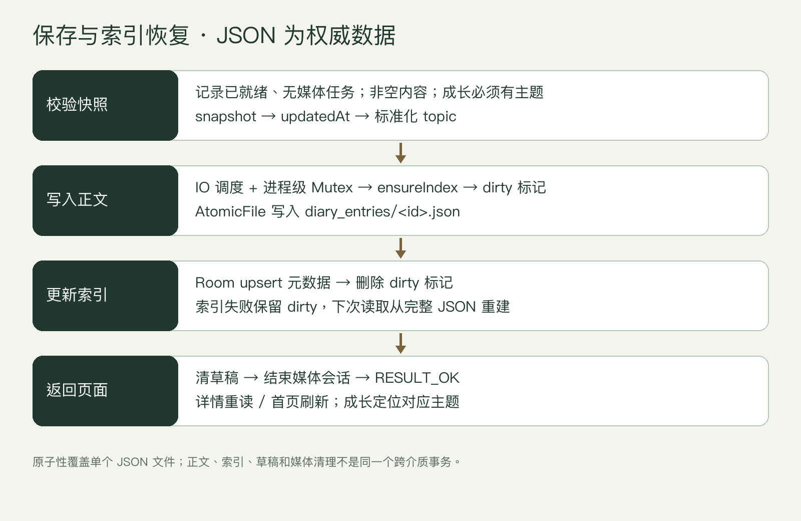

save 先校验 UUID 和成长主题，在写正文前落盘 dirty 标记；AtomicFile 写失败调用 failWrite 保留上一版本。正文提交之后，索引更新失败不会撤销正文，dirty 保留到下一次查询重建。

delete 在 IO + NonCancellable 和同一 Mutex 中执行：读取记录并恢复 AtomicFile 备份、收集记录和编辑草稿的媒体候选、删除正文和索引，再同步清草稿并清理无引用媒体。返回 false 表示记录已删除但附属清理不完整；UI 应显示清理警告，而不是“删除失败”。

清理前扫描全部已保存记录、所有草稿、pending 日志与显式 keep 集合。只删除 diary_media 目录内的 file URI，使用 canonicalPath 限定归属；引用读取失败时保守停止清理，不删除系统相册原文件。

源码依据：diary/DiaryStore.kt：save / delete / deleteUnreferencedLocked；diary/DiaryIndexStore.kt

## 媒体导入、合成与恢复

| 阶段 | 实现逻辑 |
|---|---|
| 开始任务 | begin 校验最多 9 项并去重，保存 sources 与 previous 检查点 |
| 拷贝媒体 | 复用已有私有副本；否则读取 ContentResolver，写 .part，非空后重命名 |
| 提取描述 | 图片读取宽高；视频读取宽高、旋转、时长；拒绝无效媒体 |
| 按规则合成 | 多于 1 项且至少 1 个视频时合成；纯图片不合成，单视频直接播放 |
| 提交结果 | 先将完整 result 写入 pending，再更新 StateFlow 的 active |
| 失败 / 重试 | 保留 previous；失败可重试；已导入项可重用；不完整导出删除 |
| 会话结束 | 保存或明确放弃时关闭；进程销毁保留检查点以便恢复 |

### 视频参数

使用第一个视频的显示宽高作为输出比例基准，短边缩至最多 720，不放大小尺寸输入，宽高对齐偶数。素材按选择顺序串接；图片每张 3 秒；目标 30fps；视频 H.264、音频 AAC；按适配比例留边，HDR 转 SDR，强制音轨以保留后续视频声音。

### 恢复与生命周期

DiaryMediaViewModel 持有 Application Context，配置变化时继续任务。重新绑定记录时若 pending 含完整 result 直接恢复；若只有中间状态，则提示上次处理已中断并允许重试。合成仍需重新导出，不是恢复编码器中间进度。

### 图片加载与动态照片

MediaThumbLoader 统一使用 Glide；列表缩略图默认 384px，限定 128–1280px，视频取首帧；全屏图在 2048px 内等比适配。MotionPhotoDetector 检测标准 XMP 与嵌入视频签名，用于动态照片角标；不代表已实现动态照片视频播放或独立 JPEG/MOV 配对。

源码依据：diary/DiaryMediaViewModel.kt；diary/DiaryMediaRepository.kt；diary/DiaryVideoComposer.kt；MediaThumbLoader.kt；MotionPhotoDetector.kt

## 视图、适配器与资源对应表

| 视图 XML | 直接对应代码 / 用途 |
|---|---|
| fragment_daily.xml | ui/DailyFragment：每日列表、状态与重试 |
| fragment_growth.xml | ui/GrowthFragment：主题列表、状态与重试 |
| dialog_add_entry.xml | ui/AddEntryDialogFragment：两个添加入口和取消 |
| dialog_diary_unsaved.xml | DiaryActivity：未保存内容退出确认 |
| item_daily_entry.xml | ui/DailyEntryAdapter：记录卡片、视频封面、摘要与更多 |
| item_daily_photo.xml | DailyEntryAdapter 内图片适配器：卡片轮播单页 |
| item_growth_topic.xml | ui/GrowthTopicAdapter：主题名称、篇数和展开状态 |
| item_diary_detail_media.xml | ui/DiaryDetailMediaAdapter：详情图片或视频封面 |
| item_diary_editor_row.xml | DiaryContentEditor：清单复选框 + DiaryRowEditText |
| item_media_cell.xml | AlbumAdapter：网格缩略图、时长、动态照片标志与序号 |

其余 7 个 XML 为 Activity 根布局，已在页面索引列出。AlbumSelectedAdapter 的底部选中项视图与 DiaryPageAdapter 的分页按钮通过代码创建；DiaryActivity 的媒体条也动态生成，不存在与这些动态控件一一对应的独立 XML。

公共配色见 values/colors.xml：深绿文字 #20382F、香槟金 #D9C295、暖白 surface #FFFDF7、页面底色 #F3F4EE。页面文案分别位于 diary_strings、growth_strings、daily_strings、detail_strings、photo_preview_strings 和 player_strings 等资源文件。

源码依据：app/src/main/res/layout/；app/src/main/res/values/；AlbumSelectedAdapter.kt；ui/DiaryPageAdapter.kt

## 当前边界与建议验收

| 已确认边界 | 对使用和维护的含义 |
|---|---|
| 没有业务网络层 | Retrofit 是项目协作要求，当前依赖和业务实现尚未接入；无账号与云同步链路 |
| 语音入口未接通 | DiaryActivity 注册语音结果回调，但未发现发起识别的按钮/launch 调用 |
| 相册查询一次读取全部可访问媒体 | 记录列表有索引分页，相册本身并非数据库分页；大量媒体需关注耗时和内存 |
| JSON 与索引非统一事务 | dirty 标记负责恢复；单个损坏 JSON 可能使扫描或索引重建失败 |
| 未见业务文件加密与自定义备份规则 | Manifest allowBackup=true；不应将本地存储表述为业务级加密保险箱 |

### 建议验收项目（本次未运行）

1. 新建纯文字日常、带主题成长记录，重启后可读取且各归属正确。
2. 从详情编辑并保存，列表排序和主题篇数同步更新。
3. 选择 9 项和第 10 项、跨筛选恢复选择、部分媒体授权与撤权重进。
4. 后台草稿恢复、主动退出放弃、旧草稿不覆盖新保存版本。
5. 混合照片/视频导入、取消与重试、进程中断恢复、播放进度恢复。
6. 删除记录后引用中的媒体保留，系统相册原素材不受影响。
7. 索引缺失/dirty 时重建，异常记录和存储不足显示可理解的错误。

### 本次核对范围

本次移除了旧 EditActivity、Manifest 注册和专用资源，相册统一回传选择结果，README 与文档同步更新。完成引用、XML 和改动范围静态核对；截图沿用前次采集。未执行单元测试、仪器测试、Gradle 构建或安装。项目中现有测试文件和历史报告只作为材料存在，不能视为本次验证通过。

## 截图索引与覆盖说明

| 图片文件（assets/） | 页面 / 状态 |
|---|---|
| 01-main-daily.png | MainActivity + DailyFragment |
| 02-main-growth.png | MainActivity + GrowthFragment 折叠 |
| 03-add-entry.png | AddEntryDialogFragment |
| 04-diary.png | DiaryActivity 日常 |
| 05-album.png | AlbumActivity |
| 06-album-preview.png | AlbumPreviewActivity 图片 |
| 07-diary-detail.png | DiaryDetailActivity 文字清单 |
| 08-detail-media.png | DiaryDetailActivity 图片 |
| 09-photo-preview.png | PhotoPreviewActivity |
| 10-detail-video.png | DiaryDetailActivity 视频封面 |
| 11-video-player.png | VideoPlayerActivity |
| 12-diary-growth.png | DiaryActivity 成长 |
| 13-growth-expanded.png | GrowthFragment 主题展开 |

上述 13 张图均为 2026-10-31 从连接真机采集的原始截图，包含设备上当时已有记录与媒体内容。覆盖目前保留的全部 7 个 Activity。本次清理沿用这些截图，未重新构建、安装或采集；它们用于展示界面，不代表清理后的运行验证。

架构配图：architecture.png、navigation.png、save-flow.png，为依据源码绘制的说明图。源码定位附录列出主要文件与关键方法；Word 用于阅读，Markdown 与原图用于继续维护。

## 源码定位与后续维护

| 源码位置（相对包目录） | 关键入口 |
|---|---|
| [MainActivity.kt:54](../../app/src/main/java/com/betterme/app/MainActivity.kt#L54) | fun openDiary |
| [DiaryActivity.kt:645](../../app/src/main/java/com/betterme/app/DiaryActivity.kt#L645) | private fun save |
| [DiaryActivity.kt:690](../../app/src/main/java/com/betterme/app/DiaryActivity.kt#L690) | private fun requestExit |
| [AlbumActivity.kt:300](../../app/src/main/java/com/betterme/app/AlbumActivity.kt#L300) | private fun confirmSelection |
| [AlbumPreviewActivity.kt:169](../../app/src/main/java/com/betterme/app/AlbumPreviewActivity.kt#L169) | private fun finishSelection |
| [DiaryDetailActivity.kt:84](../../app/src/main/java/com/betterme/app/DiaryDetailActivity.kt#L84) | private fun loadEntry |
| [PhotoPreviewActivity.kt:50](../../app/src/main/java/com/betterme/app/PhotoPreviewActivity.kt#L50) | private fun loadPhoto |
| [VideoPlayerActivity.kt:92](../../app/src/main/java/com/betterme/app/VideoPlayerActivity.kt#L92) | private fun preparePlayer |
| [DiaryContentEditor.kt:247](../../app/src/main/java/com/betterme/app/DiaryContentEditor.kt#L247) | private fun serialize |
| [diary/DiaryStore.kt:86](../../app/src/main/java/com/betterme/app/diary/DiaryStore.kt#L86) | suspend fun save |
| [diary/DiaryStore.kt:139](../../app/src/main/java/com/betterme/app/diary/DiaryStore.kt#L139) | suspend fun delete( |
| [diary/DiaryIndexStore.kt:26](../../app/src/main/java/com/betterme/app/diary/DiaryIndexStore.kt#L26) | fun ensureReady |
| [diary/DiaryMetadataDao.kt:29](../../app/src/main/java/com/betterme/app/diary/DiaryMetadataDao.kt#L29) | fun firstPage |
| [diary/DiaryDraftStore.kt:27](../../app/src/main/java/com/betterme/app/diary/DiaryDraftStore.kt#L27) | fun save |
| [diary/DiaryMediaRepository.kt:96](../../app/src/main/java/com/betterme/app/diary/DiaryMediaRepository.kt#L96) | suspend fun import |
| [diary/DiaryMediaViewModel.kt:78](../../app/src/main/java/com/betterme/app/diary/DiaryMediaViewModel.kt#L78) | private suspend fun run |
| [diary/DiaryVideoComposer.kt:32](../../app/src/main/java/com/betterme/app/diary/DiaryVideoComposer.kt#L32) | suspend fun export |

上表行号对应 2026-10-31 工作区源码。包目录为 app/src/main/java/com/betterme/app/。布局根目录为 app/src/main/res/layout/；Manifest、Gradle 与 schema 应一并维护。

后续更新文档时，先核对 Manifest 中 Activity 清单，再核对每个 Activity 的 Binding、根 XML 与 Intent 契约；随后对照存储目录、schema 版本和旧格式兼容逻辑。截图更新应记录安装版本、设备和日期，避免与源码说明混淆。
